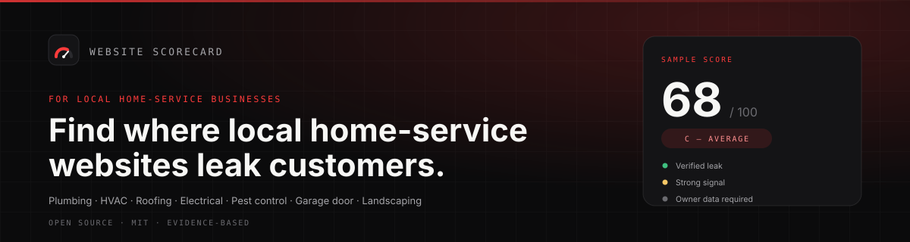
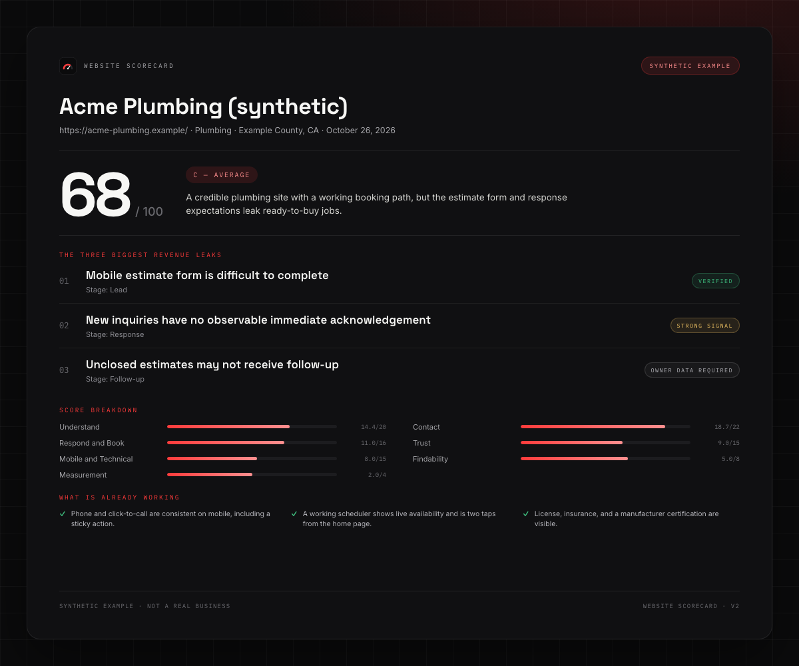
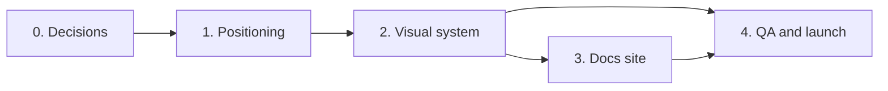

# Plan: Home-Service Positioning + Docs Visual Upgrade

**Status:** Executed and published — social preview upload remains
**Created:** 2026-10-27
**Scope:** README, `docs/`, GitHub repository presentation, optional GitHub Pages site
**Out of scope:** Scoring logic, rubric, report renderer, collector behavior, any client data

---

## TL;DR

Make the home-service audience impossible to miss, then make the docs look deliberate.

| Phase | Outcome | Effort | Risk | Gate |
|---|---|---|---|---|
| 0 | Decisions locked: audience copy, palette, docs-site go/no-go | 0.5 day | Low | Sign-off on this plan |
| 1 | README + docs state "for local home-service businesses" on the first screen | 1 day | Low | 5-second comprehension test |
| 2 | Visual system: banner, journey diagram, scorecard preview, badges, callouts | 2 days | Medium | Render review in light/dark + mobile |
| 3 | Optional docs site on GitHub Pages | 2–3 days | Medium | `mkdocs build --strict` clean, site live |
| 4 | QA, accessibility, launch guardrails | 1 day | Low | Full check green + social preview set |

**Fast path (1 day):** Phase 1 only. It solves the clarity problem and costs almost nothing.
**Full path (~6 days):** Phases 0 → 4.

---

## 1. Current state (verified, not assumed)

What is already good:

- The GitHub description already says "local home-service businesses."
- Topics already include `home-services`, `local-business`, `lead-generation`.
- `README.md` line 3 already says "local home-service websites," and line 5 names nine trades.
- `SKILL.md` and `docs/methodology.md` consistently use contractor language.
- The brand voice is sober and credible, not hypey.

Where the gap is:

- **The audience is buried in prose.** There is no scannable "Who it's for / Who it's not for" block. A visitor skimming the first screen sees a generic title, a broad paragraph, and a 12-stage ASCII diagram; the audience is stated, but never made scannable.
- **`docs/README.md` never states the audience.** Its only "home-service" string is the `.opencode/.../home-service-website-audit/` path. Same for `docs/evidence.md`, `docs/coverage-completeness.md`, `docs/release-checklist.md`, and `docs/privacy.md` (zero audience mentions).
- **Visual surface is bare.** Zero images, zero badges, zero rendered diagrams (Mermaid/SVG), no hero, no sample output image, no docs site (`has_pages: false`). All illustration is ASCII text.
- **The output is not shown early.** The 68/100 example appears as a code block far down the page; there is no visual proof of what the product produces.
- **No visual or voice standard exists** for future docs, so quality will drift.

Constraints that shape every phase:

- The repository is public. No real client screenshots, names, phone numbers, or reports. Visuals must be synthetic (`examples/acme-plumbing/`) or abstract.
- `docs/portable-checklist.md`, `docs/coverage-completeness.md`, and `references/rubric.md` are generated. Never hand-edit; change the generator or leave them alone.
- `scripts/check_links.mjs` validates relative links in Markdown but **does not inspect ``**. If we use HTML images, extend the checker first.
- `scripts/privacy_scan.mjs` scans tracked text files for secrets and PII-like values. New HTML/CSS/JS templates are in scope.
- The core pipeline has no npm dependencies. Keep it that way; any docs-site dependency must be isolated.
- Renaming `docs/README.md` affects GitHub folder browsing. It is not linked from anywhere else, so the change is safe, but decide deliberately.

---

## 2. Goals and non-goals

### Goals

1. A first-time visitor understands **who this is for within five seconds** on the README and the docs home.
2. The docs look **intentional and trustworthy**: consistent hierarchy, diagrams, callouts, and one strong sample output image.
3. Every visual asset is **synthetic or abstract**, committed, small, accessible, and regenerable.
4. No regression to privacy, link integrity, generated docs, or CI.
5. Future docs changes have a **written standard** to follow.

### Non-goals

- Redesigning the product, scoring model, or report templates.
- Implying a hosted SaaS, dashboard, or guaranteed revenue outcome.
- Publishing real client case studies or screenshots.
- Adding a JavaScript framework or heavy site generator before Phase 3 is approved.
- Maximizing badge count, emoji density, or animation.

---

## 3. Principles

1. **Positioning before decoration.** Words first; assets support the claim.
2. **One canonical audience statement.** A new `docs/audience.md` is the source; everything else links to it.
3. **Few, reusable assets.** Five assets maximum in the first pass, SVG where possible.
4. **Accessible by default.** Alt text, 4.5:1 contrast, no color-only meaning, dark-mode review.
5. **Show the output.** One honest visual of the synthetic report is worth more than three abstract diagrams.
6. **Plain, specific language.** "Find where the site may be leaking booked jobs," not "unlock conversion velocity."

---

## 4. Phases

### Phase 0 — Baseline and decisions (0.5 day)

**Purpose:** avoid designing twice.

Tasks:

- Capture baseline screenshots of README and `docs/` at 375px, 768px, and 1440px, light and dark.
- Record the audience-mention matrix and asset inventory (already started above).
- Lock the canonical one-sentence audience statement and trade list.
- Pick one palette and one logo/wordmark direction from two options.
- Decide docs-site go/no-go and the generator.
- Decide custom domain vs. `thatguynef.github.io/website-scorecard`.

Deliverables:

- `docs/audience.md` outline (copy only, no styling).
- `docs/style-guide.md` outline (voice, palette, asset rules).
- Decisions recorded at the bottom of this plan.

Done when: the four open decisions in §10 are answered and Phase 1 copy is approved.

---

### Phase 1 — Positioning (1 day)

**Purpose:** answer "is this for me?" before the reader scrolls.

Changes:

1. **Restructure the README first screen** in this order:
   - Banner image
   - H1 + tagline
   - Badge row (CI, license, version, Node, Python)
   - "Built for local home-service businesses" callout with the trade list
   - "At a glance" table (question, output, rule, not)
   - Sample scorecard image
   - Quick start
   - Then the existing content, lightly reordered

2. **Create `docs/audience.md`** as the canonical page:
   - Who the businesses are (local, scheduled service, city/metro market, phone/form/booking/estimate driven)
   - Trade list
   - Who the people are (owners, in-house marketers, local agencies, analysts)
   - Explicit "not a fit" list (SaaS, e-commerce, content sites, national brands, franchises that cannot edit their site, anyone wanting guarantees or automated fixes)
   - A five-question "is my business a fit?" checklist

3. **Add one audience line to key docs:** `docs/README.md`, `docs/methodology.md`, `docs/revenue-leak-framework.md`, `docs/scoring.md`, `docs/evidence.md`, `docs/architecture.md`, and `SKILL.md`.

4. **Update repository metadata text:** `docs/github-settings.md` description, topics, homepage, and social-preview caption. Add `contractors` and one or two trade topics only if they fit GitHub's 20-topic limit.

5. **Update guardrail docs:** `docs/release-checklist.md` and `.github/pull_request_template.md` get audience/visual checks. `CHANGELOG.md` gets an "Unreleased" entry.

Proposed README first screen (draft copy):

```markdown


# Website Scorecard

**Find where local home-service websites leak customers and revenue.**

[](https://github.com/thatguynef/website-scorecard/actions/workflows/ci.yml)
[](LICENSE)
[](CHANGELOG.md)
[](package.json)
[](package.json)

> [!NOTE]
> **Built for local home-service businesses** — plumbing, HVAC, roofing, electrical, pest control, garage door, landscaping, restoration, cleaning, and similar trades. It is also for the marketers, agencies, and analysts who serve them.

| | |
|---|---|
| **The question** | Where could this local service website be leaking leads, bookings, or revenue? |
| **The output** | A 0–100 website score, a contractor-facing one-pager, a full evidence audit, and owner-data questions |
| **The rule** | Only what the public site can prove is scored. Everything else is marked **owner data required**. |
| **What it is not** | An SEO grader, a SaaS dashboard, an automated fix, or a guarantee of revenue lift |


```

Then a short `## Who it's for` section after the sample:

```markdown
## Who it's for

**Local home-service businesses** — the trades people call when something at home is broken, dirty, unsafe, or overdue. If your customers find you in a local search, call or fill out a form, and book a job, this framework was written for you.

Also for the people who run the marketing: in-house marketers, local agencies, consultants, and analysts who need a repeatable, evidence-based second opinion instead of another SEO checklist.

**Not a fit:** SaaS, e-commerce, content or media sites, national brands with mature analytics teams, and anyone looking for a guaranteed revenue lift or an automated fix. Read the full [audience guide](docs/audience.md).
```

Acceptance criteria:

- Five-second test: three people see only the first screen and correctly say who it is for.
- `README.md` and `docs/README.md` both state the audience above their first subheading.
- No copy describes the project as a business-revenue guarantee or hosted product.
- `npm run check` passes.

Risks: over-repetition of "home service" reads as keyword stuffing. Mitigation: one strong block, short references elsewhere, never in every heading.

---

### Phase 2 — Visual system for Markdown (2 days)

**Purpose:** make GitHub rendering feel designed without adding runtime dependencies.

Asset spec:

| Asset | Size | Format | Budget | Used in |
|---|---|---|---|---|
| `docs/assets/banner.svg` | 1200×320 | SVG | < 60 KB | README top, docs home |
| `docs/assets/journey.svg` | 1200×260 | SVG | < 60 KB | README "How it works", framework |
| `docs/assets/scorecard-preview.png` | 1200×800 @2x | PNG | < 300 KB | README sample, docs home |
| `docs/assets/social-preview.png` | 1280×640 | PNG | < 1 MB | GitHub social preview (manual upload) |
| `docs/assets/logo.svg` + favicon | 64×64 | SVG | < 10 KB | Docs site header |

Design direction:

- **Palette (Radical Red Rocket brand):** ink `#0B0B0C`, surface `#141416`, card `#1C1C1F`, paper `#F7F7F5`, muted `#A6A6AA`, brand red `#FF3B3B`, soft red `#FF8F8F`, green `#3FBF7F`, amber `#F5C766`. Red is the brand accent and the leak/attention signal; green marks verified/working. Never rely on red/green alone — pair with labels and symbols.
- **Type:** Space Grotesk for display, Inter for body, IBM Plex Mono for labels in generated assets; system stacks as fallbacks. Text as text, never paths.
- **Motif:** a 12-stage journey line with a visible "leak" gap and a closing "fix" marker. Abstract, not stock photography.
- **Banner background:** dark card with light text so it reads on both GitHub light and dark themes.
- **Badges:** maximum five, all informational (CI, license, version, Node, Python). No vanity badges.

Markdown changes:

1. Replace the ASCII journey in `README.md` with `journey.svg`, and add a Mermaid status diagram to `docs/revenue-leak-framework.md` only if it adds information the table lacks.
2. Convert the `docs/architecture.md` pipeline ASCII block to a Mermaid flowchart.
3. Add a consistent "In one line" bold summary under each doc H1.
4. Add GitHub alert callouts (`> [!NOTE]`, `> [!TIP]`, `> [!WARNING]`) for definitions, guardrails, and "do not" rules.
5. Add a "Next" footer to each doc: `Next: [Scoring](scoring.md) →`.
6. Add an evidence-state legend that does not rely on color alone:

   | State | Symbol | Meaning |
   |---|---|---|
   | VERIFIED | ● | Directly observed or safely tested |
   | STRONG SIGNAL | ◐ | Evidence suggests a problem; outcome unproven |
   | OWNER DATA REQUIRED | ○ | Public site cannot answer |
   | NOT APPLICABLE | — | Does not apply to this business or market |

7. Use `<details>` for long CLI blocks and exhaustive checklists to shorten pages.
8. Keep tables to five columns or fewer; bold the decision column.

Tooling:

- Extend `scripts/check_links.mjs` to validate `` and `<picture><source srcset>` so HTML images cannot silently break.
- Add `scripts/check_assets.mjs` (Node only, no deps) to enforce: file exists, extension allowed, size budget, non-empty alt text for content images, and no `.audit/` or `reports/` paths.
- Add `npm run check:assets` and wire it into `npm run check` and CI.
- If the sample PNG is generated, add `scripts/render_docs_assets.mjs` using the already-required Chrome, rendering only `examples/acme-plumbing/` content. Commit the PNG; do not generate it in CI.

Acceptance criteria:

- README renders correctly at 375px and 1440px, light and dark.
- Every image has meaningful alt text; decorative images use empty alt.
- All assets total under 1.5 MB; no image above its budget.
- `npm run check` and `npm run check:assets` pass.
- Privacy scan shows no client data; no screenshot from `.audit/` is used.

Risk: a dark banner can look heavy. Mitigation: review both themes side by side; prefer a subtle gradient over a flat black block.

---

### Phase 3 — Docs site on GitHub Pages (2–3 days, decision gate)

**Recommendation:** MkDocs Material. Python is already required, it gives search, dark mode, navigation, and Mermaid support with one pinned dependency, and it keeps content as plain Markdown.

Why not the alternatives:

- **Astro Starlight / Docusaurus:** better marketing-site feel, but add a Node build toolchain and duplicate the content model.
- **Docsify:** zero build, but weak SEO, no build-time link validation, and a less credible look.
- **Plain GitHub rendering:** already covered by Phases 1–2; no search or navigation.

Tasks:

1. Add `requirements-docs.txt` with pinned `mkdocs-material` (and only what is needed).
2. Add `mkdocs.yml`:
   - `site_name`, `site_description`, `site_url`, `repo_url`, `edit_uri`
   - Material theme with light/dark palette, brand colors, search suggestions, code copy, navigation tabs/sections, sticky tabs, top button
   - Markdown extensions: admonition, attr_list, tables, toc permalink, `pymdownx.details`, `pymdownx.superfences` (Mermaid), `pymdownx.highlight`, `pymdownx.tabbed`
3. Add `docs/index.md` as the site landing page:
   - Hero + one-sentence pitch
   - "Built for local home-service businesses" trade chips
   - Three cards: score, report, evidence
   - Sample scorecard image
   - "Start here" paths for operators, developers, and contributors
   - Privacy and open-source note
4. Resolve the three links that escape `docs_dir`:
   - `docs/privacy.md` → `../SECURITY.md`
   - `docs/schema.md` → the two JSON Schema files
   Use absolute GitHub URLs so both GitHub and MkDocs resolve them.
5. Decide `docs/README.md`:
   - **Recommended:** rename to `docs/index.md` and delete the old file; nothing links to it today.
   - Alternative: keep `docs/README.md` as the documentation index and make `docs/index.md` the landing page (two pages, clear roles).
6. Add `docs/assets/extra.css` for brand tokens, hero, cards, score badge, and table polish.
7. Add `.github/workflows/docs.yml`:
   - Build with `--strict` on pull requests.
   - Deploy on push to `main` using `actions/configure-pages`, `upload-pages-artifact`, and `deploy-pages`.
   - Permissions: `contents: read`, `pages: write`, `id-token: write`; concurrency group.
8. Enable Pages manually (Settings → Pages → Source: GitHub Actions) and document it in `docs/release-checklist.md`.
9. Link the live site from the README and the repository About section.

Navigation proposal:

```text
Home · Who it's for · Why this exists · Framework · Scoring · Evidence · Coverage
Guides: Architecture · Configuration · Schema · Portable checklist · Development
Reference: V1 → V2 migration · Legacy V1 · Privacy · Release checklist
Project: Contributing · Security · Changelog (external GitHub links)
```

Acceptance criteria:

- `mkdocs build --strict` completes with zero warnings.
- Deployed URL loads; search, dark mode, mobile nav, and Mermaid all work.
- Lighthouse: accessibility ≥ 95, performance ≥ 90 on mobile.
- No 404s in the built site; `site_url` and canonical URLs are correct.
- The site adds no dependency to the core pipeline and no runtime JavaScript beyond the theme.

Risks: dependency drift (pin versions, dependabot optional), duplicate content between README and site home (README is the canonical summary; the site home mirrors it and links to source), manual Pages enablement (documented, not assumed).

---

### Phase 4 — QA, launch, and guardrails (1 day)

Tasks:

- Visual QA matrix: Chrome, Safari, Firefox; light and dark; 375 / 768 / 1440 px.
- Accessibility pass: heading order, alt text, contrast, link text, table headers, keyboard navigation on the docs site.
- Add `docs/style-guide.md` and link it from `CONTRIBUTING.md` under Documentation.
- Add release-checklist items: audience present, images have alt text, asset budgets, docs build strict, social preview current.
- Update `CHANGELOG.md` and `docs/github-settings.md`.
- Upload `social-preview.png` in GitHub settings (manual).
- Optional: a 30–60 second demo GIF under 2 MB, only if it shows real value rather than decoration.
- Announce in the README footer or release notes, not with a marketing splash.

Acceptance criteria:

- Full gate green: `npm run check`, `npm run check:assets`, and the docs build.
- Manual accessibility and mobile sign-off.
- Social preview visible on the repository.
- No open "visual TODO" placeholders in tracked docs.

---

### Phase 5 — Optional later (not scheduled)

- Interactive scorecard demo or a filterable sample gallery.
- Auto-generated report screenshots from a synthetic fixture in CI.
- Custom domain and privacy-friendly analytics.
- Localized docs (only if the audience needs it).

---

## 5. Dependency graph



Phase 1 is independently shippable. Phase 2 does not require Phase 3. Phase 4 always runs last.

---

## 6. File map

| File | Phase | Change |
|---|---|---|
| `PLAN.md` | 0 | This plan (delete or archive after execution) |
| `docs/audience.md` | 1 | New canonical audience page |
| `README.md` | 1–2 | New first screen, sample, diagrams, badges |
| `docs/README.md` | 1, 3 | Audience line; likely becomes `docs/index.md` |
| `docs/methodology.md` | 1–2 | Audience line, callouts, next footer |
| `docs/revenue-leak-framework.md` | 1–2 | Audience line, journey visual |
| `docs/scoring.md` | 1–2 | Audience line, legend, table polish |
| `docs/evidence.md` | 1–2 | Audience line, state legend |
| `docs/architecture.md` | 1–2 | Audience line, Mermaid pipeline |
| `docs/configuration.md` | 2 | Callouts, next footer |
| `docs/schema.md` | 3 | Absolute schema links for MkDocs |
| `docs/privacy.md` | 3 | Absolute SECURITY link for MkDocs |
| `docs/github-settings.md` | 1, 4 | Metadata and social preview guidance |
| `docs/release-checklist.md` | 1, 4 | Audience and visual checks |
| `docs/style-guide.md` | 0, 4 | New voice, color, asset, and diagram rules |
| `docs/assets/*` | 2–3 | Banner, journey, preview, social, logo, CSS |
| `mkdocs.yml`, `requirements-docs.txt` | 3 | Site configuration and pinned dependency |
| `.github/workflows/docs.yml` | 3 | Build on PR, deploy on main |
| `scripts/check_links.mjs` | 2 | Validate HTML images |
| `scripts/check_assets.mjs` | 2 | New asset budget and alt-text check |
| `scripts/render_docs_assets.mjs` | 2 | Optional synthetic PNG generation |
| `package.json` | 2 | `check:assets`, `docs:build`, `docs:serve` |
| `CHANGELOG.md` | 1, 4 | Unreleased entry |
| `.github/pull_request_template.md` | 1 | Audience and visual checklist |

Do not touch: `docs/portable-checklist.md`, `docs/coverage-completeness.md`, `references/rubric.md`, or any generated JSON. If their presentation must change, update the generator.

---

## 7. Proposed docs home outline

```text
Website Scorecard
Find where local home-service websites leak customers and revenue.

[Built for local home-service businesses]  Plumbing · HVAC · Roofing · Electrical · Pest · Garage · Landscaping · Restoration · Cleaning

[See a sample report]   [Read the framework]

Why this exists
Most graders stop at technical health. A contractor loses the job when a homeowner
cannot tell what the company does, cannot tap the phone, or never hears back.

What you get
[Score /100]   [One-page report]   [Full audit + evidence]   [Owner-data questions]

Sample output
[Screenshot of the synthetic Acme Plumbing report: 68/100, three leaks]

Start here
For operators →   For developers →   For contributors →

Public by design: synthetic examples only, no client data.
```

---

## 8. Content guardrails

Say:

- "may be leaking"
- "observed" / "not observed"
- "owner data required"
- "local home-service business"
- "booked jobs," "estimates," "service area"

Do not say:

- "guaranteed revenue lift"
- "we will fix your site"
- "AI-powered growth engine"
- "dashboard" or "platform" unless describing a future product honestly
- "SEO score" as a synonym for this score

Never publish:

- real client names, logos, screenshots, phone numbers, or report contents
- screenshots from `.audit/` or `reports/`
- stock photos of generic contractors presented as customers

---

## 9. Risks and mitigations

| Risk | Likelihood | Impact | Mitigation |
|---|---|---|---|
| Visuals imply a SaaS product | Medium | High | Copy guardrail; no dashboard mockups; explicit "what it is not" |
| Client data leaks through a screenshot | Low | High | Synthetic fixture only; privacy scan in CI; asset check blocks `.audit/` paths |
| Generated docs overwritten by hand edits | Medium | Medium | Never edit generated files; update generators; `check:generated` in CI |
| Link checker misses `` | High | Low | Extend `check_links.mjs` in Phase 2 |
| MkDocs dependency rot | Medium | Medium | Pin versions; isolate in `requirements-docs.txt`; content stays plain Markdown |
| Duplicate README and site home drift | Medium | Medium | README is canonical; site home mirrors and links to source; review both in Phase 4 |
| Visual scope creep | High | Medium | Five-asset budget; phase gates; no animation before Phase 4 |
| Brand mismatch with Radical Red Rocket | Medium | Medium | Palette sign-off in Phase 0; neutral palette that can coexist |
| Renaming `docs/README.md` breaks GitHub browsing | Medium | Low | Choose the two-file variant if folder preview matters |

---

## 10. Open decisions (needed before Phase 1)

1. **Docs site:** build the GitHub Pages site now (Phase 3), or ship Phases 1–2 first and decide after?
   *Recommendation:* Phases 1–2 now; Phase 3 immediately after, because the content will already be site-ready.
2. **Domain:** `thatguynef.github.io/website-scorecard` first, or a custom subdomain such as `scorecard.radicalredrocket.com`?
   *Recommendation:* GitHub URL first; custom domain later, after the site proves useful.
3. **Palette:** neutral ink/amber/teal, or align to Radical Red Rocket brand colors?
   *Decision (2026-10-27):* align to the Radical Red Rocket brand — near-black `#0B0B0C` surfaces, off-white `#F7F7F5`, brand red `#FF3B3B`, with green/amber for evidence states.
4. **Sample output:** rendered synthetic report screenshot, or a designed scorecard illustration?
   *Recommendation:* rendered synthetic report, because it is honest and shows the real artifact. No stock photos.

---

## 11. Suggested pull requests

1. `docs: add audience page and clarify home-service positioning` — Phase 1.
2. `docs: add visual identity, diagrams, and asset checks` — Phase 2.
3. `docs: add MkDocs site and GitHub Pages deploy` — Phase 3.
4. `docs: launch QA, style guide, and release guardrails` — Phase 4.

Each PR includes before/after screenshots (light and dark, mobile and desktop) and the commands run.

---

## 12. Definition of done

- A first-time visitor can answer "who is this for?" from the first screen alone.
- `docs/audience.md` is the single canonical audience statement and is linked from README, docs home, and repository metadata guidance.
- Every tracked image is synthetic/abstract, under budget, has alt text, and renders in light and dark mode.
- The README shows the output, not just describes it.
- All links and assets validate; CI is green; privacy scan is clean.
- If Phase 3 ships: the docs site is live, searchable, accessible, and built with a pinned, isolated toolchain.
- `CHANGELOG.md`, `docs/release-checklist.md`, and `CONTRIBUTING.md` reflect the new standard.
- `PLAN.md` is removed or archived once the work is complete.

---

## Execution record — 2026-10-27

### Completed locally

- **Phase 1:** README first screen, `docs/audience.md`, audience notes across the docs, metadata/release/PR guidance, changelog.
- **Usage guide:** `docs/run-an-audit.md` covers entering the website URL, every input, the judgment pass, each output type, verification, and troubleshooting.
- **CTA policy:** one CTA block per page on `audience.md`, `run-an-audit.md`, and the README, plus a top exit link on the audit guide; UTM-tagged and documented in `docs/style-guide.md`.
- **Phase 2:** Banner, journey diagram, sample report preview, social preview, logo, favicon; Mermaid pipeline; callouts and next-step footers; `check_assets.mjs`; HTML image support in `check_links.mjs`.
- **Phase 3:** MkDocs Material site, branded landing page, theme CSS, GitHub alert hook, pinned docs toolchain, Docs workflow with Pages auto-enablement.
- **Phase 4:** Style guide, contributor rules, release checklist, PR template, responsive and light/dark review, social preview asset.

### Verification

- `npm run check` — pass (tests, rubric, generated docs, schemas, links, assets, privacy).
- `mkdocs build --strict` — pass.
- Lighthouse accessibility — 100 on `/`, `/scoring/`, `/audience/`, and `/architecture/`.
- Internal site crawl — 778 references, 0 broken.
- SVG files — valid XML.
- Badge endpoints — HTTP 200.
- `docs/assets` — 340 KB total; largest image 118 KB.
- Brand palette — ink `#0B0B0C`, surface `#141416`, paper `#F7F7F5`, red `#FF3B3B`, green `#3FBF7F`, amber `#F5C766`.

### Remaining publish steps (need repository access)

- [x] Commit and push to `main`.
- [x] Confirm the `Docs` workflow deploys and Pages is enabled (the workflow requests auto-enablement).
- [ ] Upload `docs/assets/social-preview.png` in GitHub repository settings.
- [ ] Optionally apply the description, topics, and homepage from `docs/github-settings.md`.

The site is live at `https://thatguynef.github.io/website-scorecard/`.

---

## Decisions log

| Date | Decision | Owner | Notes |
|---|---|---|---|
| 2026-10-27 | Plan drafted | — | Approved for execution |
| 2026-10-27 | Palette aligned to Radical Red Rocket brand | Nefer | Near-black + `#FF3B3B`, off-white, green/amber states |
| 2026-10-27 | Docs site: MkDocs Material on GitHub Pages | Nefer | Phases 1–4 executed |
| 2026-10-27 | Sample output: rendered synthetic report | Nefer | Generated from `examples/acme-plumbing/` |
