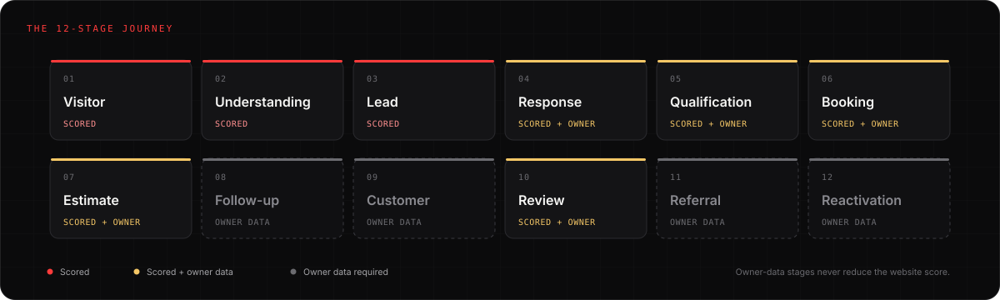
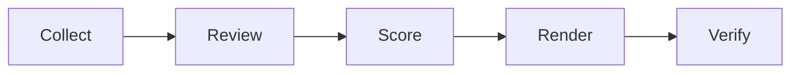

# Website Scorecard

**Find where local home-service websites leak customers and revenue.**

[](https://github.com/thatguynef/website-scorecard/actions/workflows/ci.yml)
[](LICENSE)
[](CHANGELOG.md)
[](package.json)
[](package.json)

> [!NOTE]
> **Built for local home-service businesses** — plumbing, HVAC, roofing, electrical, pest control, garage door, landscaping, restoration, cleaning, and similar trades. It is also for the marketers, agencies, and analysts who serve them. Read the [audience guide](docs/audience.md).

| At a glance | |
|---|---|
| **The question** | Where could this local service website be leaking leads, bookings, or revenue? |
| **The output** | A 0–100 website score, a contractor-facing one-pager, a full evidence audit, and the owner-data questions the site cannot answer |
| **The rule** | Only what the public site can prove is scored. Everything else is marked **owner data required**. |
| **What it is not** | An SEO grader, a SaaS dashboard, an automated fix, or a guarantee of revenue lift |


*Synthetic example — not a real business. Read the [one-page report](examples/acme-plumbing/one-page.md) or the [full audit](examples/acme-plumbing/full-report.md).*

## Who it's for

**Local home-service businesses** — the trades people call when something at home is broken, dirty, unsafe, or overdue. If your customers find you in a local search, call or fill out a form, and book a job, this framework was written for you.

It is also for the people who run the marketing: in-house marketers, local agencies, consultants, and analysts who need a repeatable, evidence-based second opinion instead of another SEO checklist.

**Not a fit:** SaaS, e-commerce, content or media sites, national brands with mature analytics teams, and anyone looking for a guaranteed revenue lift or an automated fix. [Read the audience guide →](docs/audience.md)

## Quick start

Requirements: Node.js 22+, Python 3.10+, and Google Chrome or Chromium. Lighthouse is optional for development, but a delivered audit needs three mobile runs (or a documented waiver).

```sh
git clone https://github.com/thatguynef/website-scorecard.git
cd website-scorecard
npm run doctor
npm test
```

Run an audit:

```sh
npm run audit -- \
  --url "https://example.com" \
  --client "Example Co." \
  --trade plumbing \
  --city "San Diego" \
  --service plumbing \
  --max-pages 12 \
  --lh-runs 3
```

The entrypoint writes raw evidence to `.audit/example/<run-id>/` and creates the report package at `reports/example.com/<run-id>/`. Fill the judgment checks in `audit.json`, save the result as `reports/example.com/<run-id>/audit.filled.json`, then score, render, and verify. The step-by-step version, including what each input means and how to get each output type, is [Run an audit](docs/run-an-audit.md).

<details>
<summary><strong>Stage-by-stage commands</strong></summary>

```sh
python3 .opencode/skills/home-service-website-audit/scripts/score.py \
  --input reports/example.com/<run-id>/audit.filled.json \
  --out reports/example.com/<run-id>/scores.json \
  --markdown reports/example.com/<run-id>/scorecard.md \
  --strict

node .opencode/skills/home-service-website-audit/scripts/render.mjs \
  --scores reports/example.com/<run-id>/scores.json \
  --content reports/example.com/<run-id>/content.json \
  --out "reports/example.com/<run-id>/one-page.md"

node .opencode/skills/home-service-website-audit/scripts/render.mjs --mode full \
  --scores reports/example.com/<run-id>/scores.json \
  --content reports/example.com/<run-id>/content.json \
  --out "reports/example.com/<run-id>/full-report.md"

node .opencode/skills/home-service-website-audit/scripts/index.mjs \
  --reports reports/index.local.md \
  --client "Example Co." --market "Example County, CA" \
  --score <score> --band "<band>" --date 2026-10-26 \
  --one-page example.com/<run-id>/one-page.md \
  --full example.com/<run-id>/full-report.md

node .opencode/skills/home-service-website-audit/scripts/verify.mjs \
  --run .audit/example/<run-id> \
  --filled reports/example.com/<run-id>/audit.filled.json \
  --scores reports/example.com/<run-id>/scores.json \
  --report reports/example.com/<run-id>/full-report.md \
  --one-page reports/example.com/<run-id>/one-page.md \
  --index reports/index.local.md \
  --out reports/example.com/<run-id>/verification.json \
  --mutation --fixture
```

</details>

Each report package is local and covered by the `reports/*` ignore rule; only `reports/README.md` is tracked. Every public CLI supports `--help`.

## Documentation

Start with [Who this is for](docs/audience.md), then [Run an audit](docs/run-an-audit.md) and [Why this exists](docs/methodology.md). The full index is in [docs/README.md](docs/README.md). The same content deploys to `https://thatguynef.github.io/website-scorecard/` through `.github/workflows/docs.yml`.

## Why it exists

Traditional website graders optimize for technical health: SEO, performance, metadata, accessibility. Those matter. But a contractor does not lose a job because a meta description is 12 characters too long. A contractor loses a job when a homeowner cannot tell what the company does, cannot tap the phone number, cannot finish the form, cannot book a slot, or never hears back.

The website is the observable front end of a larger revenue system. This project diagnoses the front end honestly and marks the rest as **owner data required** instead of pretending the public site can see the CRM.

The most important distinction:

```text
WEBSITE SCORE                 REVENUE OPPORTUNITIES TO INVESTIGATE
observable, scored            owner/CRM data, never scored
```

A good website with unknown internal processes should score well **and** produce follow-up questions. It should not be penalized for estimate follow-up, response time, or reactivation that the audit cannot see.

## What it does

- Collects mobile and desktop screenshots, DOM signals, Lighthouse data, a site map, and non-destructive conversion-path traces.
- Scores the observable website out of **100** with applicability-aware category weights and hard caps.
- Separates **verified website findings** from **strong signals** and **owner-data opportunities**.
- Produces a contractor-facing one-pager, a full audit, a machine-readable `scores.json`, and a coverage matrix.
- Verifies the run with invariants, cross-artifact checks, and mutation tests.
- Preserves the legacy 42-check V1 rubric so historical scores keep their meaning.

## How it works





Collection is deterministic. Only judgment checks use a model. Scoring, rendering, and verification are file-based and reproducible, and each stage stays independently runnable for debugging. `npm run audit` is a wrapper, not a monolith.

## Revenue Leak Framework

The framework covers 12 journey stages:

| Stage | What the public site can show | Owner data |
|---|---|---|
| Visitor | Findability, speed, layout, HTTPS | — |
| Understanding | Service, location, outcome, action, offer, language | — |
| Lead | Phone, form, scheduler, SMS/chat, dead ends, measurement | — |
| Response | Response promise, after-hours path | Speed-to-lead, missed calls |
| Qualification | Routing fields | Lead quality, spam, routing |
| Booking | Booking steps, confirmation | Capacity, reschedules |
| Estimate | Estimate workflow | Pipeline, turnaround, close rate |
| Follow-up | Not observable | Follow-up cadence, attempts, reactivation |
| Customer | Not observable | History, repeat rate |
| Review | Reviews, testimonials, profile link | Review-request process |
| Referral | Public referral signals if present | Referral operations |
| Reactivation | Maintenance/membership signals if present | Inactive customers, unsold estimates |

Read the full [Revenue Leak Framework](docs/revenue-leak-framework.md). The area-by-area completeness map is [docs/coverage-completeness.md](docs/coverage-completeness.md). The machine-readable coverage matrix is `references/coverage-matrix.json`.

## Scoring

| Category | Weight |
|---|---|
| A. Understand | 20 |
| B. Contact | 22 |
| C. Respond and Book | 16 |
| D. Trust | 15 |
| E. Mobile and Technical | 15 |
| F. Findability | 8 |
| G. Measurement | 4 |
| **Total** | **100** |

Bands: 90–100 A · 75–89 B · 60–74 C · 40–59 D · 0–39 F.

Optional modules (language, SMS, chat, after-hours, licensing) are scored only when configured. Financing, video, memberships, tiers, paid priority, content freshness, and paid-traffic risk are opportunity flags, not universal penalties. N/A checks are removed from the denominator and category weights are normalized.

Full math, caps, and worked examples: [docs/scoring.md](docs/scoring.md). Canonical rubric: `references/rubric.json`.

## Evidence rules

Every finding is one of:

- **VERIFIED** — directly observed or safely tested.
- **STRONG SIGNAL** — evidence strongly suggests a problem, but the business outcome cannot be proven.
- **OWNER DATA REQUIRED** — cannot responsibly determine from public information.
- **NOT APPLICABLE** — the check does not reasonably apply to this business, market, or configuration.

> [!IMPORTANT]
> The system never says "this contractor responds slowly" unless response time was measured with authorization. It says "no immediate acknowledgement mechanism was observed" and asks the owner for the real number.

Read [docs/evidence.md](docs/evidence.md).

## Examples

- [`examples/acme-plumbing/`](examples/acme-plumbing/) — synthetic V2 example: **68/100**, one verified leak, one strong signal, one owner-data opportunity.
- [`examples/legacy-v1-roofing/`](examples/legacy-v1-roofing/) — sanitized legacy V1 example: **36/100**, preserved so historical scores remain reproducible.

Both are synthetic or sanitized. No real client data is published.

## Project structure

```text
.opencode/skills/home-service-website-audit/
  SKILL.md                    audit workflow
  references/
    rubric.json               canonical V2 rubric
    rubric.md                 generated
    coverage-matrix.json      generated
    v2-one-page-template.md
    v2-report-template.md
    fix-library.md
    schema/                   JSON Schemas
    legacy/                   preserved V1 rubric
  scripts/
    collect.mjs               collector
    score.py                  scorer + validator
    render.mjs                report renderer
    verify.mjs                delivery gate
    eval.mjs                  cross-model eval
    fixtures/                 V1/V2 golden fixtures
docs/                         methodology, scoring, evidence, architecture, etc.
docs/index.md                 documentation landing page
docs/assets/                  brand assets, diagrams, and generated previews
examples/                     synthetic/sanitized examples
config/                       example market configuration
scripts/                      entrypoint, doctor, link/asset/privacy checks
mkdocs.yml                    documentation site configuration
requirements-docs.txt         pinned docs toolchain
.github/workflows/ci.yml      CI
.github/workflows/docs.yml    documentation build and deploy
```

## Development

```sh
npm test                 # scorer + pipeline tests
npm run check            # tests, rubric, generated docs, schemas, links, assets, privacy
npm run check:generated  # fail if generated docs are stale
npm run check:assets     # image existence, alt text, and size budgets
npm run check:privacy    # secret/PII safety net
npm run render:assets    # regenerate the sample and social previews (Chrome required)
npm run eval -- --mock --snapshot examples/acme-plumbing --out /tmp/eval-mock
```

Build the docs site locally:

```sh
python3 -m venv .venv-docs
.venv-docs/bin/pip install -r requirements-docs.txt
.venv-docs/bin/mkdocs serve
.venv-docs/bin/mkdocs build --strict
```

Do not hand-edit generated files. `rubric.json` is the single source of truth.

Read [docs/development.md](docs/development.md) before adding a check.

## Contributing

See [CONTRIBUTING.md](CONTRIBUTING.md). Documentation voice, colour, and asset rules are in [docs/style-guide.md](docs/style-guide.md). Repository description/topic recommendations are in [docs/github-settings.md](docs/github-settings.md).

Every check must answer at least one of:

- Can this cost the business a lead?
- Can this prevent a booking?
- Can this weaken trust?
- Can this waste traffic?
- Can this hide a revenue opportunity?
- Can this prevent measurement?

Do not maximize the number of checks. Maximize the usefulness, credibility, reproducibility, and clarity of the diagnosis.

## Privacy

This is a **public** repository.

- Raw audit evidence stays local in `.audit/` and `audit-screens/`.
- Client reports are local by default in `reports/<domain>/<run-id>/` and are gitignored.
- Client-specific configs are local in `config/` and are gitignored except for `config/market.example.json`.
- Never commit credentials, customer PII, private screenshots, or production data.
- Public examples must be synthetic or sanitized and labeled as such.
- The public repository was deleted and recreated from a clean root commit on 2026-10-26 to remove earlier real-client audit artifacts. The old commit is not available in the new repository.
- Old clones, forks, browser caches, and third-party mirrors may still contain the earlier revision. Delete your old clone and re-clone. If you forked the repository, delete or recreate the fork.
- Any third-party keys that appeared in the old history should be treated as exposed. Read [docs/privacy.md](docs/privacy.md).

## License

[MIT](LICENSE).

## Radical Red Rocket

Website Scorecard is maintained alongside [Radical Red Rocket](https://radicalredrocket.com), which uses it as the diagnostic framework behind live Revenue Leak Teardowns. The Scorecard diagnoses; remediation is a separate system. The open-source toolkit is useful without hiring anyone.

The documentation and assets use the Radical Red Rocket palette: near-black surfaces, off-white type, and signal red `#FF3B3B`.
