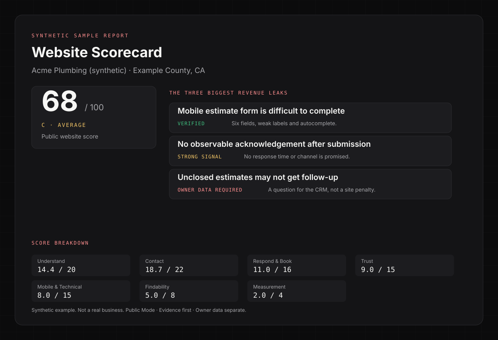
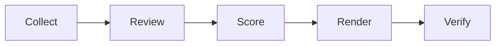

<section class="ws-hero">
  <div class="ws-hero__copy">
    <p class="ws-eyebrow">FOR LOCAL HOME-SERVICE BUSINESSES</p>
    <h1>Find where your website leaks booked jobs.</h1>
    <p class="ws-lede">Website Scorecard scores what the public site can prove, separates verified leaks from owner-data questions, and produces a contractor-facing report in one run.</p>
    <div class="ws-actions">
      <a class="ws-btn ws-btn--primary" href="run-an-audit/">Run an audit</a>
      <a class="ws-btn" href="audience/">Who it's for</a>
      <a class="ws-btn" href="revenue-leak-framework/">See the framework</a>
    </div>
    <p class="ws-trades">Plumbing · HVAC · Roofing · Electrical · Pest control · Garage door · Landscaping · Restoration · Cleaning</p>
  </div>
  <figure class="ws-hero__media">
    
    <figcaption>Synthetic sample report</figcaption>
  </figure>
</section>

## What you get

<div class="grid cards ws-cards-4" markdown>

-   :material-gauge:{ .lg .middle } **A score you can defend**

    ---

    A 0–100 score across seven weighted categories. N/A checks leave the denominator, so the score never inflates.

-   :material-file-document-outline:{ .lg .middle } **A report a contractor will read**

    ---

    Three leaks, the evidence behind each, the fix, and the questions only the owner can answer.

-   :material-magnify-scan:{ .lg .middle } **Evidence states, not opinions**

    ---

    VERIFIED, STRONG SIGNAL, OWNER DATA REQUIRED, or NOT APPLICABLE. Every finding is labeled.

-   :material-database-outline:{ .lg .middle } **Machine-readable output**

    ---

    `scores.json`, a coverage matrix, and a verification gate for downstream tools.

</div>

## How it works



Collection is deterministic. Only judgment checks use a model. Scoring, rendering, and verification are file-based and reproducible. Read the [architecture](architecture.md) if you want the details.

## Start here

<div class="grid cards" markdown>

-   **I own or market a home-service business**

    ---

    Start with [who this is for](audience.md) and [why this exists](methodology.md).

-   **I want to run an audit**

    ---

    Enter the website URL, fill the judgment checks, and render the report. See [Run an audit](run-an-audit.md).

-   **I want to extend the rubric**

    ---

    Read the [architecture](architecture.md) before adding a check.

</div>

## A coordinated scorecard family

```text
LOCAL VISIBILITY
      ↓
GBP SCORECARD
      ↓
WEBSITE SCORECARD
      ↓
RAD
```

Three independent diagnostics, used in journey order:

<div class="grid cards" markdown>

-   :material-map-search:{ .lg .middle } **[Local Visibility Scorecard](https://thatguynef.github.io/local-visibility-scorecard/)**

    ---

    Can prospective customers discover the business across Search, Maps, AI answers, competitors, and external authority?

    [Open the Local Visibility Scorecard →](https://thatguynef.github.io/local-visibility-scorecard/)

-   :material-storefront:{ .lg .middle } **[GBP Scorecard](https://thatguynef.github.io/gbp-scorecard/)**

    ---

    Does the Google Business Profile create trust and enable action — before the customer reaches the website?

    [Open the GBP Scorecard →](https://thatguynef.github.io/gbp-scorecard/)

-   :material-web:{ .lg .middle } **Website Scorecard** · you are here

    ---

    Can the owned website turn that demand into a lead, booking, or estimate?

    [Open the Website Scorecard →](https://thatguynef.github.io/website-scorecard/)

</div>

The boundaries, shared evidence states, and no-duplicate-scoring matrix are in [The Scorecard Family](scorecard-family.md).

## Public by design

> [!NOTE]
> Every public example is synthetic or sanitized. The repository never ships real client screenshots, reports, or customer data. The Scorecard diagnoses; remediation is a separate system.

Website Scorecard is maintained alongside [Radical Red Rocket](https://radicalredrocket.com), which uses it as the diagnostic framework behind live Revenue Leak Teardowns.
